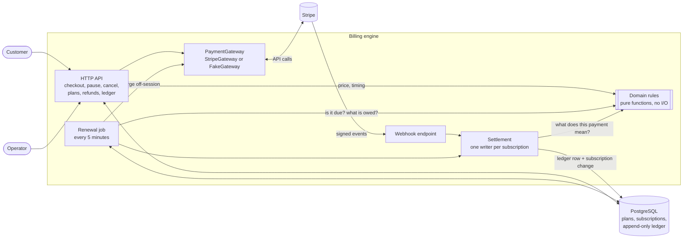
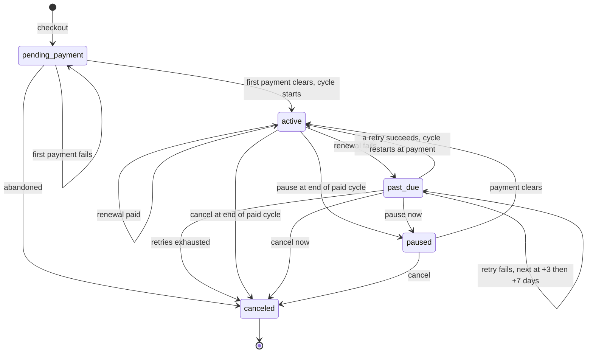
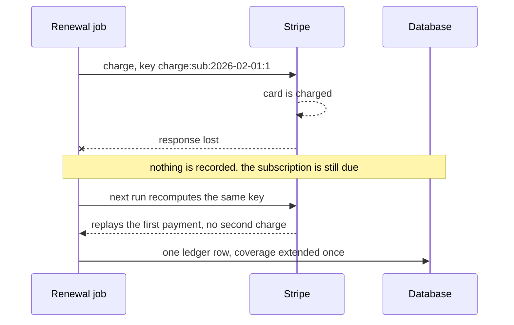

# Subscription Billing Engine

[](https://github.com/TTB8/subscription-billing-engine/actions/workflows/ci.yml)
[](LICENSE)
[](.github/workflows/ci.yml)
[](tsconfig.base.json)

A production-grade reference implementation of **Stripe subscription billing**:
fixed-day cycles, prepaid terms, dunning, refunds, and webhooks and renewals that
are safe to run twice.

Most teams get billing wrong in the same four places. They bill by calendar month
and fight the 31st. They prorate, and owe customers fractions of cents. They retry
a failed charge and occasionally charge twice. They handle a webhook once and in
order, which providers do not promise. This project is what it looks like when each
of those is designed out instead of patched: the rules are small pure functions, the
payment provider is behind an interface, every charge carries a key derived from
state, and the money ledger cannot be rewritten.

It is built to be read. Start with [the design decisions](#design-decisions), then
open [`packages/domain`](packages/domain), the whole rulebook in about a dozen files.

## What it does

- **Fixed-length cycles, not calendar months.** A plan's cycle is a number of days
  (default 28). Each cycle starts when the customer's **first successful payment
  clears**, never on a calendar date. No proration anywhere.
- **Prepaid terms.** Pay 3 cycles at 10% off ("12 weeks") or 6 at 15% off ("24 weeks"),
  configured per plan, named by length and never in months.
- **An explicit lifecycle.** `pending_payment → active → past_due → (active | canceled)`,
  plus `paused`. Every legal transition is in one table; anything else throws.
- **Dunning.** A failed renewal moves to `past_due` and retries at +1, +3 and +7 days
  from the original due date, then cancels. A late payment restarts the cycle at the
  payment date, not at its old place in the schedule.
- **Pause and cancel at the end of the paid cycle**, or at once if nothing is paid
  forward. Nothing is refunded on a mid-term cancel.
- **Refunds.** Admin endpoint, full or partial, recorded in the ledger, never more than
  was charged, safe under concurrent requests.
- **Idempotent webhooks.** Signatures verified on the raw body, event ids stored, the
  same event twice or out of order changes nothing.
- **Idempotent renewals.** A scheduled job charges what is due, off-session. Running it
  twice, on two servers at once, or after a lost response never double charges.
- **An auditable ledger.** Every charge, failure and refund is an append-only row.

## Architecture



Three packages, one direction of dependency:

```
packages/domain    pure billing rules: no framework, database or provider imports
packages/gateway   the PaymentGateway contract, a Stripe implementation, an in-memory fake
apps/api           NestJS: reads state, asks the rules, writes the result. No billing decisions
```

The API contains no billing decisions. It reads a row, calls a function in
`packages/domain`, and writes the answer back. ESLint fails the build if the domain
imports NestJS, Prisma or Stripe.

## Subscription lifecycle



## The hard part: a charge whose answer never arrives

The case that causes double charges in practice is the card being charged and the
response getting lost. Here is how the engine handles it:



The key is derived from the subscription, its due date and the attempt number, so
every repeat of the same operation sends the same key. The end-to-end tests hold two
runs at the provider at the same moment, and drop a response after the provider has
charged, to show it. See [decision 0005](docs/decisions/0005-derived-idempotency-keys.md).

## Design decisions

The short version. Each links to a record with the alternative and what it costs, in
[`docs/decisions`](docs/decisions/README.md).

**Fixed cycles over calendar months.** A calendar month is 28 to 31 days, depends on a
timezone, and puts a customer who started on the 31st in a special case in every shorter month.
A cycle is `cycleDays × 24h` of UTC time from the instant payment cleared. Leap years and
daylight saving cannot affect it, because there is no calendar code. The cost is 13
charges a year instead of 12, which is a pricing decision, not a bug.
([0001](docs/decisions/0001-fixed-day-cycles.md))

**No proration.** Proration is mid-cycle arithmetic, and each piece of it is a chance to
bill the wrong amount. Here a cycle is the unit of sale: it starts when payment clears,
a late payment restarts it, cancel and pause wait for the cycle to end, and nothing is
owed back. A refund is a deliberate admin action, never a side effect.
([0002](docs/decisions/0002-no-proration.md))

**Idempotency keys derived from state.** A random or time-based key makes every retry a
new request. These are a pure function of what is being paid for, so the job can crash,
overlap itself or lose a response and still charge once. If something changes between a
lost response and its retry (a price, say), the provider rejects the repeat and the
subscription is flagged for a person, never silently charged again.
([0005](docs/decisions/0005-derived-idempotency-keys.md), [0008](docs/decisions/0008-provider-outcomes.md))

**Integer money.** Amounts are integer cents and discounts are basis points, rounded half
up with integer arithmetic. A prepaid term's discount is applied once to the total, so a
3-cycle term is never a cent off from rounding each cycle. All timestamps are UTC.
([0009](docs/decisions/0009-integer-money-and-utc.md))

**The payment provider behind an interface.** Billing depends on `PaymentGateway`.
`StripeGateway` is the production implementation. `FakeGateway` reproduces what billing
relies on (idempotent replays, declines as results, signed webhooks, outages, lost
responses), so the failures that matter can be tested on demand instead of hoped for.
([0004](docs/decisions/0004-gateway-interface-and-fake.md))

Also: all rules in a [pure domain package](docs/decisions/0003-pure-domain-package.md), an
[append-only ledger](docs/decisions/0006-append-only-ledger.md) with the guarantees
enforced by the database itself, and
[webhooks that deduplicate atomically](docs/decisions/0007-webhook-processing.md) and
decide from an event's content, not its arrival order.

## Quickstart

You need Node 20+, pnpm and Docker. Booting the API needs Stripe **test-mode** keys
(it refuses live ones, and fails at startup, listing what is missing, if they are absent).
The tests need no keys at all; skip to [Testing](#testing) to run those first.

```bash
docker compose up -d                          # Postgres 16 on localhost:5433
pnpm install
cp apps/api/.env.example apps/api/.env        # then fill in the three values below
pnpm db:reset                                 # migrate and seed two plans
pnpm dev                                      # API on http://localhost:3000, docs at /docs
```

In `apps/api/.env`:

| Variable                | Where to get it                                              |
| ----------------------- | ------------------------------------------------------------ |
| `STRIPE_SECRET_KEY`     | Stripe dashboard → Developers → API keys (the `sk_test_` key) |
| `STRIPE_WEBHOOK_SECRET` | `stripe listen --print-secret` (Stripe CLI)                  |
| `ADMIN_API_KEY`         | any random string of 16+ characters                          |

Then:

```bash
curl -s localhost:3000/plans    # every plan with each purchase option priced
```

## Testing

```bash
pnpm lint            # ESLint, including the rule that every export is documented
pnpm typecheck       # strict TypeScript
pnpm test            # unit tests, no database
pnpm test:cov        # with coverage; the domain and gateway packages enforce thresholds
pnpm test:e2e        # the real app against Postgres, with the fake provider
pnpm test:cov:api    # API unit and e2e tests together, merged coverage and a floor
```

The domain package has **100% coverage**, including leap years, daylight-saving dates,
retry exhaustion, pausing while past due, and repeated or out-of-order failures. The end-to-end suite
runs the real application against a real Postgres, and tells whole customer stories
through the public API:

- a loyal customer: checkout, two renewals, and a cancel that waits for the paid cycle to end
- a card that works at checkout, fails at renewal, and is fixed by the customer
- a card that never recovers: exactly four attempts, then a clean cancel
- a prepaid 12-week term with a pause that waits for the term to end

Each story ends by checking that the ledger agrees with what the provider says it
charged, failed and refunded. Other tests hold two renewal runs at the provider at once,
drop a response after the provider has charged, deliver the same webhook five times
concurrently, and deliver two declines and a late payment in all six possible orders,
each event twice, to prove the outcome never changes. The guarantees enforced by the
database (one successful charge per period, an append-only ledger) are attacked directly.

The tests are checked as well as run. Deliberately breaking a rule (making the charge
key depend on the time, removing the stale-event check) makes specific tests fail; that
is how weak tests were found and replaced while building this.

CI runs all of this on Node 20 and 22 against a Postgres service, and publishes a
coverage table to each run.

## Try it with Stripe test mode

The tests use a fake provider. To check the real integration with the Stripe CLI, follow
[docs/stripe-test-mode.md](docs/stripe-test-mode.md). It walks through a first payment,
a renewal, a failing renewal, the retry schedule, recovery, a refund and a cancel, with
a helper script (`scripts/demo.sh`) to move time along without waiting 28 days.

| Purpose                               | Value                                                        |
| ------------------------------------- | ------------------------------------------------------------ |
| Successful card                       | `4242 4242 4242 4242`, any future date, any CVC              |
| Attaches fine, every charge declines  | `pm_card_chargeCustomerFail` (card `4000 0000 0000 0341`)    |

Note that `4000 0000 0000 0341` is declined at checkout in this flow, because Checkout
charges the card immediately. To simulate a card that works first and fails at renewal,
pay with `4242`, then swap the saved card; the guide shows how.

## Project layout

```
packages/domain/     pure billing rules (README inside)
packages/gateway/    PaymentGateway, StripeGateway, FakeGateway (README inside)
apps/api/            NestJS app, Prisma schema and migrations (README inside)
docs/decisions/      why the engine is built the way it is
docs/stripe-test-mode.md   the manual walkthrough with the Stripe CLI
scripts/demo.sh      helpers for that walkthrough
.github/             CI, issue and pull request templates, Dependabot
```

## Out of scope

This is a reference implementation, and it leaves these out on purpose. Each is a real
requirement for production.

- **Customer authentication.** Subscription routes identify a subscription by its id
  alone. A real product puts a login in front of them.
- **Operator accounts.** Admin routes use one shared key (`x-admin-key`, compared in
  constant time, and refused entirely if unset).
- **Collecting a replacement card.** A customer fixing a failed card needs a Stripe
  SetupIntent flow. The walkthrough swaps the saved card with SQL instead.
- **Resuming a paused subscription on request.** The rules support it (a payment that
  clears resumes it, restarting the cycle), but there is no customer endpoint for it.
- **Refunds and disputes made in the Stripe dashboard.** Only refunds made through
  this API are recorded.
- **Plan changes mid-cycle, and locked prices.** A renewal charges the plan's current
  price, so a price change takes effect at the next renewal.
- **Tax, invoices, receipts and dunning emails.** Notification and document concerns.
- **Currencies without two decimal places**, and amounts above about 21 million major
  units (see [decision 0009](docs/decisions/0009-integer-money-and-utc.md)).
- **A web front end, rate limiting, and metrics or alerting.**

## Contributing and security

See [CONTRIBUTING.md](CONTRIBUTING.md) for setup, standards and how to add a rule,
[SECURITY.md](SECURITY.md) to report a vulnerability, and the
[changelog](CHANGELOG.md). This is MIT licensed: see [LICENSE](LICENSE).

---

Built by [TTB8](https://github.com/TTB8), available for consulting.
